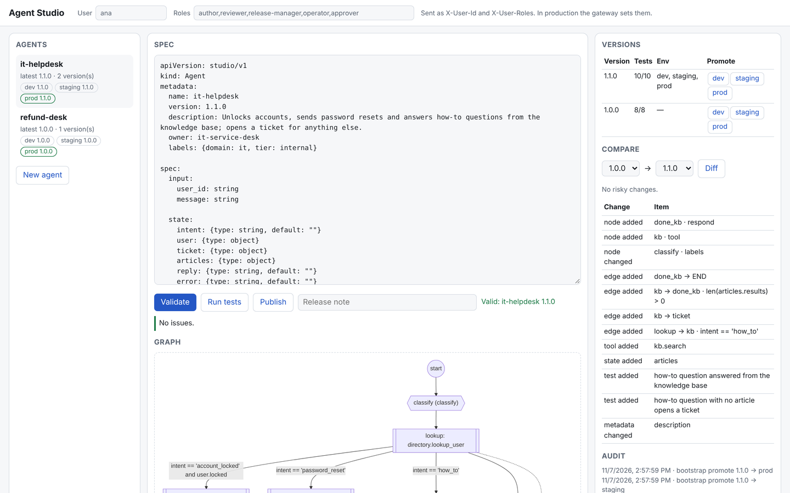

# No-Code Agent Studio

[](https://github.com/darshansatpathy/no-code-agent-studio/actions/workflows/ci.yml)
[](https://github.com/darshansatpathy/no-code-agent-studio/actions/workflows/codeql.yml)


**Agents written as YAML instead of code, checked before they run, compiled to LangGraph,
and released like software: immutable versions, dev → staging → prod, test gates, a
risk review on every promotion, and an audit trail.**

Teams want to build agents without writing Python, and platform owners want to know
exactly what those agents can do. This studio gives both: a spec says which nodes run,
which tools they may call, with what limits, and when a person must approve. The platform
owns the tools, the expression language and the runtime, so a spec can do no more than
what it declares.



```yaml
tools:
  - use: payments.issue_refund
    approval: "args.amount > 100"        # a person approves larger refunds
    limits: {amount: {max: 500}}         # and nothing above 500 EUR is ever sent
nodes:
  - id: refund
    type: tool
    tool: payments.issue_refund
    args: {order_id: order_id, amount: amount, reason: reason}
    on_error: review                     # denied, blocked or failed: a colleague takes over
edges:
  - {from: amount, to: refund, when: "reason in ['damaged', 'not_received']"}
  - {from: amount, to: review}
tests:
  - name: refund above the hard limit is never issued
    input: {message: "My order O-5003 never arrived"}
    expect: {path: [find_order, reason, lookup, amount, refund, review], not_tools: [payments.issue_refund]}
```

---

## Try it

```bash
python -m venv .venv && . .venv/bin/activate
pip install -e ".[dev]"
studio demo                 # publish the examples and walk through a release
make serve                  # then open http://localhost:8080/studio
```

`studio demo` publishes the three example specs and then:

```text
Trying to put 1.1.0 straight into prod:
  refused: it-helpdesk 1.1.0 must be promoted to staging before prod
  after staging: prod is 1.1.0

A 1.2.0 that drops the approval on password resets passes its tests, but prod says:
  refused: high-risk changes since prod 1.1.0: approval removed from directory.reset_password.
  Review them and promote again with acknowledge_risk
```

That last refusal is the point of the risk review. Every test still passes, because no
test covers a privileged user who was never asked for approval. The diff catches it
instead.

```bash
studio validate agents/refund-desk/v1.0.0.yaml     # schema and static analysis, with line numbers
studio test agents/refund-desk/v1.0.0.yaml         # the spec's own tests
studio diff agents/it-helpdesk/v1.0.0.yaml agents/it-helpdesk/v1.1.0.yaml
studio run agents/refund-desk/v1.0.0.yaml --input '{"message": "O-5002 arrived broken"}' --approve
studio check agents                                # the CI gate for a repository of specs
```

## What the analyzer catches

Before a spec can be published or run, it is parsed into typed models and analyzed.
Errors point at the YAML line:

```text
error: line 92: edge to unknown node 'done_rest' (spec.edges[5].to) [unknown_node]
error: line 88: 'usr' is not a state field (declare it under spec.state) (spec.edges[1].when) [unknown_name]
error: line 27: only these functions are allowed: coalesce, contains, len, ... (spec.tools[2].approval) [expression]
warning: line 74: node 'done_reset' cannot be reached from 'classify' [unreachable_node]
```

| Check | Examples |
|---|---|
| Structure | unknown node in an edge or `on_error`, duplicate ids, missing entry, node with no way out |
| Graph | nodes unreachable from the entry, nodes that can never reach `END`, loops (bounded by `max_steps`), edges after an unconditional one, no default route |
| Data | conditions and templates reading undeclared fields, writes to undeclared fields, `input.x` not in the input schema |
| Tools | tool not in the catalog or not declared, missing or unknown arguments, limits on arguments that don't exist, write tools with neither approval nor limits |
| Expressions | anything outside the whitelist: calls other than a dozen pure functions, attribute access on objects, comprehensions, lambdas, dunder names |
| Tests | inputs not in the schema, expected nodes or tools that don't exist, duplicate names; no tests at all means no promotion past dev |

## Releasing an agent

| Step | Rule |
|---|---|
| **Publish** | Needs the author role. Spec must analyze clean. The version is immutable: same name and version with different content is refused, identical content is a no-op, and versions only go up. Tests run and the result is stored with the version. |
| **dev** | Any published version. |
| **staging** | Reviewer role, every spec test passing, at least one test. |
| **prod** | Release-manager role, tests passing, and the version must have been in staging. If the diff against the current prod version contains a high-risk change, the promotion is refused until it is acknowledged. |
| **Rollback** | Promote an earlier version; the audit log marks it as a rollback. |
| **Runs** | Resolve the version pinned to an environment (or an exact version), and stay pinned to it, so a run waiting for approval resumes with the spec it started with. |

Risk rules in the diff: a write tool added (high without approval or limits), an approval
removed (high) or changed (medium), a limit removed or raised (high), allowed values
widened (high), a larger tool budget (medium), tests removed (medium), changed arguments
to a write tool (medium), an input removed (medium).

## The spec language

Six node types: `classify` (keywords, or a model choosing from the listed labels),
`extract` (a regex with one group), `tool`, `set`, `respond` and `generate` (template, or
a model rewriting a draft). Edges are evaluated in order; the first whose `when` holds is
taken. Expressions are a small safe language parsed with Python's `ast` and checked
against a whitelist; templates use `{{ expression }}`. The full reference, with every
field, is in [docs/spec-reference.md](docs/spec-reference.md).

A model, when configured, can only pick one of the spec's labels or write text into a
state field. It cannot choose the route or call tools, so its output never widens what the
agent does.

## HTTP API and the studio page

`studio serve` serves the page at `/studio` and the API under `/v1`.

| Endpoint | Role | Purpose |
|---|---|---|
| `POST /v1/specs/validate`, `POST /v1/specs/test` | any | Analyze or test a draft; returns issues with lines and the Mermaid graph |
| `POST /v1/agents` | author | Publish a version |
| `GET /v1/agents`, `/v1/agents/{name}`, `/versions/{v}`, `/diff`, `/audit` | any | Browse versions, environments, diffs, history |
| `POST /v1/agents/{name}/promote` | reviewer, release-manager | Promote through the gates |
| `POST /v1/agents/{name}/runs` | operator | Run the version in an environment |
| `GET /v1/runs/{id}`, `POST /v1/runs/{id}/approval` | operator, approver | Inspect a run; approve or deny a paused tool call |
| `GET /v1/catalog`, `/healthz`, `/metrics` | any | Tools with argument schemas, health, Prometheus counters |

Roles come from the gateway in front of the service (`X-User-Id`, `X-User-Roles`). With
`STUDIO_SERVICE_TOKEN` set, only callers presenting it can assert them.

## Kubernetes

[deploy/k8s](deploy/k8s) has a kustomize base and two overlays:

- **dev**: one replica, in-memory store, the bundled example agents promoted to every
  environment at start-up.
- **prod**: two to six replicas (HPA), a PodDisruptionBudget, PostgreSQL and the service
  token from a Secret, image from GitHub Container Registry.

Both run as a non-root user with a read-only root filesystem, no service-account token,
all capabilities dropped and the `restricted` Pod Security level on the namespace, plus a
NetworkPolicy. CI validates both overlays with kubeconform, then creates a kind cluster,
deploys the dev overlay, and publishes, runs, approves and loads the studio page through
the Service. Tagging a release pushes the image to `ghcr.io/darshansatpathy/no-code-agent-studio`.

```bash
make kind-deploy     # build, load into kind, apply the dev overlay
kubectl -n agent-studio port-forward svc/agent-studio 8080:80
```

`docker compose up` runs the studio on PostgreSQL locally.

## Engineering

- 122 tests, 99% line coverage (gate: 90%), including PostgreSQL for the registry and run
  checkpoints, a restart test for a paused run, and the expression sandbox.
- `ruff`, `mypy --strict`, Python 3.11 to 3.13.
- `studio check agents` validates and tests every spec in CI and writes a table to the run
  summary.
- CodeQL (security-extended), pip-audit, Dependabot.

## Layout

```
src/agentstudio/
  spec.py          spec models, YAML loading with line numbers, content hashes
  expr.py          the safe expression and template language
  analyzer.py      static analysis
  catalog.py       typed tools and the simulated systems behind them
  compiler.py      spec → LangGraph StateGraph, Mermaid
  runtime.py       start, pause for approval, resume, inspect
  testing.py       a spec's own tests
  registry.py      versions, environments, promotion gates, audit
  diffing.py       structural diff and risk review
  api.py, cli.py, config.py, models_io.py, web/studio.html
agents/            example specs (IT helpdesk 1.0.0 and 1.1.0, refund desk)
deploy/k8s/        kustomize base and overlays
docs/              architecture, spec reference, threat model, ADRs
```

## Known limits

- The tools act on in-memory simulations of a directory, ticketing, orders, payments and a
  knowledge base. A real deployment registers its own tools in the catalog.
- Exactly-once tool calls across process crashes are not handled here; see
  [multi-agent-ops-automation](https://github.com/darshansatpathy/multi-agent-ops-automation)
  for the ledger and idempotency-key approach.
- The studio page is a single static file with no build step; it is for authors and
  reviewers, not end users.

## License

MIT. See [LICENSE](LICENSE).
