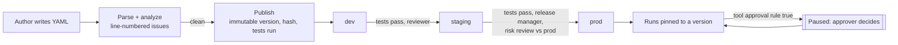

# Architecture

## From YAML to a graph

1. **Load.** `yaml.compose` keeps a map from every path to its line; `yaml.safe_load` gives
   the data; Pydantic models with `extra="forbid"` validate it. Schema errors carry the line.
2. **Analyze.** `analyzer.py` checks references, data flow, tool contracts, expressions,
   graph shape and tests (see the README table). Errors block publishing and compiling;
   warnings are stored with the version.
3. **Compile.** `compiler.py` turns each node into a LangGraph node that does its one job,
   appends itself to the run's path, and chooses the next node by evaluating its edges in
   order. Expressions are compiled once, at compile time.
4. **Run.** `runtime.py` starts runs with validated input, checkpoints after every node,
   and caches compiled graphs by content hash.

## The expression sandbox

Conditions, arguments, assignments and templates all use one language. It is parsed with
Python's `ast` module in `eval` mode and every node of the tree is checked against a
whitelist before the spec is accepted; evaluation walks the tree with its own interpreter.
There is no `eval`, no attribute access on Python objects, no calls except a fixed set of
pure functions, and bounds on expression length, tree size, string growth and division by
zero. Reading through mappings returns `null` for missing keys.

## Tool calls

A tool node evaluates its arguments, then in order: checks the spec's limits for each
argument, checks the run's tool budget, evaluates the approval rule (with `args` in scope)
and pauses with `interrupt()` if it is true, then calls the catalog tool, whose own
Pydantic model validates the arguments strictly. Any failure is recorded on the run's call
list with its status (`blocked`, `denied`, `error`) and routed to `on_error` or fails the run.

## Versions and environments

The registry stores each version's YAML, content hash, body hash (everything but the version
number), test result and warning count. Environments are pointers from `(agent, env)` to a
version. Promotions and publishes are appended to an audit table with the actor and
details: previous version, test result, whether it was a rollback, and which high-risk
findings were acknowledged.

Runs record which version they started on. Approvals resume that version's compiled graph,
even if a newer version has been promoted since.

## Storage

| Store | Registry | Run checkpoints |
|---|---|---|
| memory | SQLite in memory | `InMemorySaver` |
| sqlite | SQLite file | `SqliteSaver` |
| postgres | PostgreSQL | `PostgresSaver` |

With PostgreSQL, several replicas share versions, environments and paused runs.

## Deployment

The kustomize base defines the Deployment (non-root, read-only root filesystem, no
service-account token, probes on `/healthz`), Service and NetworkPolicy. The dev overlay
bootstraps the example specs; the prod overlay adds PostgreSQL and the service token from a
Secret, two to six replicas and a PodDisruptionBudget. CI deploys the dev overlay to a kind
cluster and drives a publish, run and approval through the Service.
